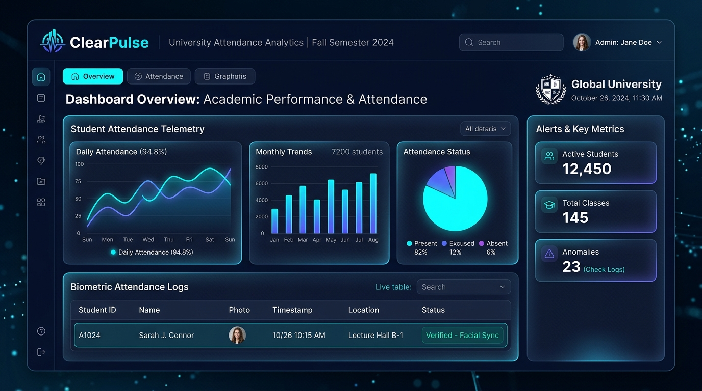
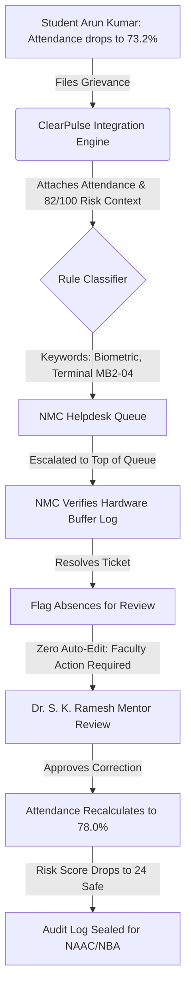

# ClearPulse — Unified Classroom Intelligence & Explainable Helpdesk

<div align="center">



### **Bannari Amman Institute of Technology, Sathyamangalam (BIT Sathy)**
*Authorized Institutional Domain: `@bitsathy.ac.in`*

[](https://github.com/minashto/ClassPulse)
[](https://github.com/minashto/ClassPulse)
[](https://react.dev)
[](https://www.typescriptlang.org)
[](https://vitejs.dev)
[](https://opensource.org/licenses/MIT)

**One connected platform bridging classroom telemetry with institutional helpdesk operations.**

</div>

---

## 🎯 The Core Problem: Slipped vs. System Failed Them?

When a student's attendance or marks drop at BIT Sathy, the institution previously had no way to distinguish whether the student **slipped academically** or an **underlying campus system failed them** — such as:
- A biometric reader network packet drop on terminal `#MB2-04`.
- A PS Portal or PCDP On-Duty (OD) entry delay.
- An unresolved examination revaluation result in the COE system.

Because the classroom tracking tool (**ClassPulse**) and the student grievance ticketing system (**Helpdesk**) were siloed:
1. **Teachers chased students** for problems that belonged to a technical department (e.g., NMC or PS).
2. **Departments handled tickets** in a generic FIFO queue without knowing if a student was on the brink of debarment (<75% attendance).
3. **Absences remained uncorrected**, leading to wrongful debarment risks and mentor frustration.

---

## 💡 The ClearPulse Solution

**ClearPulse** combines **ClassPulse** (attendance, real-time confusion telemetry, early-warning dropout risk scoring) and the **Helpdesk** (deterministic rule-based routing to NMC, PS, COE, or Office Academics) into **one connected platform with single institutional college login (`@bitsathy.ac.in`)**.



---

## 🔑 Key Design Choices

> [!IMPORTANT]
> ### 1. Ticket Sorting Stays Rule-Based & Explainable
> Grievances are classified using a **100% deterministic, explainable rule engine** based on weighted N-grams across official BIT Sathy taxonomies. If keywords conflict across departments or have zero match, the ticket routes safely to **Manual Review & Triage** so staff assign it without arbitrary guesswork.

> [!TIP]
> ### 2. Teachers See Only Category & Status (Privacy Guard)
> To protect student confidentiality and institutional governance, **faculty mentors see only a ticket's verified category and status**, never the full grievance text or personal comments.

> [!CAUTION]
> ### 3. A Human Approves Every Attendance Correction
> **Nothing changes automatically.** When a department resolves a ticket, affected absences are flagged as `FLAGGED_FOR_REVIEW`. Only a verified faculty mentor can inspect the diagnostic notes and sign off to update records to `PRESENT`.

---

## 🎬 Arun Kumar's Case Study Walkthrough

Evaluators can follow Arun's prototype journey using the **Guided Journey Bar** or instant **Role Switcher** at the top of the interface:

| Step | Persona | Action & Interface State | Impact on System |
| :---: | :--- | :--- | :--- |
| **1** | 👨‍🎓 **Student (Arun)** | Attendance is **73.2%** (<75%), Risk is **82/100 (HIGH)**. Files ticket `BIT-2026-1042` with claimed dates Oct 18 & 21. | Academic context (73.2% attendance) is automatically attached to the ticket. |
| **2** | 🏢 **NMC Staff** | Opens NMC Queue. Arun's ticket is **ranked at the top** with `🚨 CRITICAL: AT-RISK STUDENT`. | Department acts on the grievance with priority before exam debarment lock. |
| **3** | 👨‍🏫 **Teacher (Faculty)** | In ClassPulse, Dr. Ramesh sees Arun flagged with `"2 Open Biometric Tickets (NMC)"`. | Teacher knows not to chase the student while under technical review. |
| **4** | 🏢 **NMC Staff** | Investigates Terminal `#MB2-04` log buffer and clicks **"Verify & Resolve (Flag Absences)"**. | Absences marked for review. Ticket status becomes `RESOLVED`. |
| **5** | 👨‍🏫 **Teacher (Faculty)** | Receives amber banner: *"2 Absences Marked for Review"*. Clicks **"Sign Off Review"** and approves. | **Attendance jumps to 78.0% (>75%)** and **Risk Score drops to 24/100 (LOW)**! |

---

## 🏛️ Official Department Taxonomy & Keyword Mapping

| Department | Department Scope | Official Categories | Primary Keywords & N-Grams |
| :--- | :--- | :--- | :--- |
| **NMC** | Network Maintenance Cell | 1. Biometric system issues<br>2. Wi-Fi and LAN<br>3. Access points<br>4. Connectivity | `biometric`, `fingerprint`, `thumb scanner`, `biometric reader`, `mb2-04`, `wifi`, `lan`, `captive portal`, `router` |
| **PS** | PS & Student Affairs | 1. PS Portal<br>2. PCDP App<br>3. Attendance issues<br>4. On-Duty (OD) entry | `ps portal`, `pcdp app`, `attendance`, `od entry`, `on duty`, `leave application`, `medical leave` |
| **COE** | Controller of Examinations | 1. Examination issues<br>2. Timetable<br>3. Results and grade cards | `exam`, `timetable`, `hall ticket`, `results`, `grade card`, `revaluation`, `arrear`, `marksheet` |
| **Office Academics** | Academic Affairs | 1. Mini-projects<br>2. Academic project matters<br>3. Guide approval | `mini-project`, `academic project`, `project guide`, `guide approval`, `zeroth review`, `capstone` |
| **Manual Review** | Manual Triage | 1. Cross-department conflicts<br>2. Ambiguous complaints | Fallback when keywords conflict or match 0 official categories |

---

## 🧪 Comprehensive Automated Test Suite

ClearPulse includes an automated native test runner verifying all design choices:

```bash
npm test
```

### Verified Test Cases:
- ✔ **Test 1:** Arun biometric reader complaint maps deterministically to NMC.
- ✔ **Test 2:** PS Portal OD entry maps deterministically to PS.
- ✔ **Test 3:** Revaluation and grade card issues map to COE.
- ✔ **Test 4:** Mini-project guide approval maps to Office Academics.
- ✔ **Test 5:** Multi-department conflicts route safely to Manual Review.
- ✔ **Test 6:** Zero-match out-of-scope complaints route to Manual Review.
- ✔ **Test 7:** Student academic risk prioritization rule escalates at-risk tickets.
- ✔ **Test 8:** Human-in-the-loop rule guarantees zero automatic record modification.

---

## 🚀 Quickstart & Installation

### Prerequisites
- Node.js `v20+` or `v22+`
- npm `v10+`

### 1. Clone & Install
```bash
git clone https://github.com/minashto/ClassPulse.git
cd ClassPulse
npm install
```

### 2. Run Tests
```bash
npm test
```

### 3. Launch Development Server
```bash
npm run dev
```
Open **`http://localhost:5173/`** in your browser to experience the prototype.

### 4. Build for Production
```bash
npm run build
```

---

## 📑 Repository Structure

```
ClassPulse/
├── .github/
│   ├── workflows/ci.yml             # GitHub Actions CI for tests & build
│   ├── ISSUE_TEMPLATE/              # Bug report & feature request templates
│   └── pull_request_template.md     # PR checklist ensuring design choice compliance
├── docs/
│   └── hero-banner.jpg              # High-resolution dashboard mockup
├── src/
│   ├── types/index.ts               # Domain TypeScript interfaces
│   ├── utils/classifier.ts          # Deterministic, explainable rule classifier
│   ├── data/mockData.ts             # BIT Sathy institutional datasets & Arun's case study
│   ├── context/AppContext.tsx       # State management, role switcher & human sign-off
│   ├── components/
│   │   ├── Navbar.tsx               # Top bar with role switcher
│   │   ├── GuidedJourneyBar.tsx     # Step-by-step interactive case study banner
│   │   ├── TicketDetailModal.tsx    # Privacy-guarded ticket modal
│   │   └── AttendanceCorrectionModal.tsx # Human approval sign-off drawer
│   ├── views/
│   │   ├── StudentView.tsx          # Student portal with live attendance ledger
│   │   ├── TeacherView.tsx          # ClassPulse mentor matrix & debarment alerts
│   │   ├── DepartmentView.tsx       # NMC queue prioritized by student risk
│   │   ├── AdminView.tsx            # Executive breakdown: "Slipped vs System Failure"
│   │   ├── ClassifierDemoView.tsx   # Live classifier test sandbox
│   │   └── CrossSystemView.tsx      # System architecture & RBAC privacy matrix
│   ├── App.tsx                      # Root application shell
│   └── index.css                    # Glassmorphism cyber-academic design system
├── tests/
│   └── classification.test.mjs      # 8 automated unit test suites
├── ARCHITECTURE.md                  # Detailed mathematical & technical specifications
├── CONTRIBUTING.md                  # Contribution & design invariant guidelines
├── LICENSE                          # MIT License
└── package.json
```

---

<div align="center">

**Developed for Bannari Amman Institute of Technology, Sathyamangalam**  
*Single institutional college login & zero automatic attendance manipulation policy enforced.*

</div>
